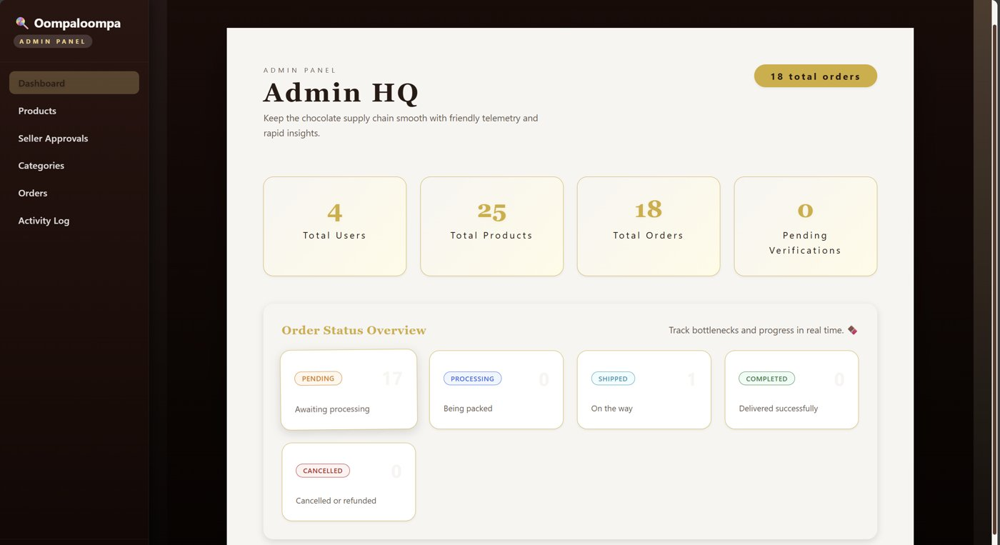

# 🍫 Chocolata MVP

A scalable, accessible, and testable e-commerce platform for chocolate products with role-based flows for buyers, sellers, and admins.

**Live demo:** [chocolata-mvp-ksrb.vercel.app](https://chocolata-mvp-ksrb.vercel.app/catalog)



<sub>Admin dashboard (early version, from before the project was renamed to Chocolata)</sub>

## 🚀 Tech Stack

- **Frontend**: React 18 + Vite + TypeScript
- **Routing**: React Router v6
- **Styling**: CSS Modules
- **Forms**: React Hook Form + Zod
- **State Management**: Redux Toolkit
- **Backend**: Supabase (Auth, Database, Storage)
- **Animations**: Framer Motion
- **i18n**: i18next
- **Testing**: Playwright (E2E)

## 📦 Installation

1. Clone the repository
2. Install dependencies:

```bash
npm install
```

3. Set up environment variables:

```bash
cp .env.example .env
```

Edit `.env` and add your Supabase credentials:
```
VITE_SUPABASE_URL=your_supabase_project_url
VITE_SUPABASE_ANON_KEY=your_supabase_anon_key
```

## 🗄️ Supabase Database Setup

You'll need to create the following tables in your Supabase database:

### `users` table
```sql
CREATE TABLE users (
  id UUID PRIMARY KEY REFERENCES auth.users(id),
  email TEXT NOT NULL,
  full_name TEXT,
  role TEXT NOT NULL CHECK (role IN ('buyer', 'seller', 'admin')),
  created_at TIMESTAMP WITH TIME ZONE DEFAULT NOW()
);
```

### `products` table
```sql
CREATE TABLE products (
  id UUID PRIMARY KEY DEFAULT gen_random_uuid(),
  seller_id UUID NOT NULL REFERENCES users(id),
  name TEXT NOT NULL,
  description TEXT,
  price DECIMAL(10, 2) NOT NULL,
  category TEXT,
  stock INTEGER DEFAULT 0,
  image_url TEXT,
  is_active BOOLEAN DEFAULT true,
  created_at TIMESTAMP WITH TIME ZONE DEFAULT NOW(),
  updated_at TIMESTAMP WITH TIME ZONE DEFAULT NOW()
);
```

### `orders` table
```sql
CREATE TABLE orders (
  id UUID PRIMARY KEY DEFAULT gen_random_uuid(),
  user_id UUID NOT NULL REFERENCES users(id),
  seller_id UUID REFERENCES users(id),
  total_amount DECIMAL(10, 2) NOT NULL,
  status TEXT NOT NULL DEFAULT 'pending',
  shipping_address TEXT NOT NULL,
  shipping_name TEXT NOT NULL,
  shipping_email TEXT NOT NULL,
  created_at TIMESTAMP WITH TIME ZONE DEFAULT NOW()
);
```

### `order_items` table
```sql
CREATE TABLE order_items (
  id UUID PRIMARY KEY DEFAULT gen_random_uuid(),
  order_id UUID NOT NULL REFERENCES orders(id),
  product_id UUID NOT NULL REFERENCES products(id),
  quantity INTEGER NOT NULL,
  price DECIMAL(10, 2) NOT NULL,
  created_at TIMESTAMP WITH TIME ZONE DEFAULT NOW()
);
```

### `seller_verifications` table
```sql
CREATE TABLE seller_verifications (
  id UUID PRIMARY KEY DEFAULT gen_random_uuid(),
  user_id UUID NOT NULL REFERENCES users(id),
  status TEXT NOT NULL DEFAULT 'pending' CHECK (status IN ('pending', 'approved', 'rejected')),
  document_url TEXT,
  created_at TIMESTAMP WITH TIME ZONE DEFAULT NOW()
);
```

### `categories` table
```sql
CREATE TABLE categories (
  id UUID PRIMARY KEY DEFAULT gen_random_uuid(),
  name TEXT NOT NULL UNIQUE,
  description TEXT,
  created_at TIMESTAMP WITH TIME ZONE DEFAULT NOW()
);
```

### Storage Bucket

Create a storage bucket named `seller_docs` for seller verification documents.

## 🏃 Development

Start the development server:

```bash
npm run dev
```

The app will be available at `http://localhost:3000`

## 🧪 Testing

Run Playwright E2E tests:

```bash
npm test
```

Run tests with UI:

```bash
npm run test:ui
```

## 📁 Project Structure

```
src/
├── components/          # Reusable components
│   ├── ui/             # Base UI components (Button, Input, Modal, etc.)
│   ├── forms/          # Form components (LoginForm, ProductForm, etc.)
│   ├── cards/          # Card components (ProductCard, etc.)
│   ├── layout/         # Layout components (BuyerLayout, SellerDashboardShell, etc.)
│   └── animations/     # Animation components (FadeIn, etc.)
├── pages/              # Page components
│   ├── buyer/         # Buyer pages (Catalog, Cart, Checkout, etc.)
│   ├── seller/        # Seller pages (Dashboard, Products, Orders, etc.)
│   └── admin/         # Admin pages (Dashboard, Sellers, Categories, etc.)
├── routes/             # Routing configuration
├── store/              # Redux store and slices
├── contexts/           # React contexts (AuthContext, etc.)
├── lib/                # Utility libraries (supabaseClient, i18n, etc.)
├── locales/            # i18n translation files
└── styles/             # Global styles

tests/
├── e2e/                # Playwright E2E tests
│   ├── buyer/         # Buyer flow tests
│   ├── seller/        # Seller flow tests
│   └── admin/         # Admin flow tests
└── utils/              # Test utilities
```

## 🎯 Features

### 👤 Buyer
- User registration and login
- Browse product catalog
- Add products to cart
- Complete checkout with order confirmation

### 🧑‍🍳 Seller
- Registration with seller verification (ID upload)
- Dashboard with product statistics
- Create and edit products
- View order overview

### 🛡️ Admin
- Approve/reject seller applications
- Manage product categories
- Monitor order flow
- View platform statistics

## 🌍 Internationalization

The app supports multiple languages (English and German by default). Translation files are located in `src/locales/`.

## 📝 License

MIT

